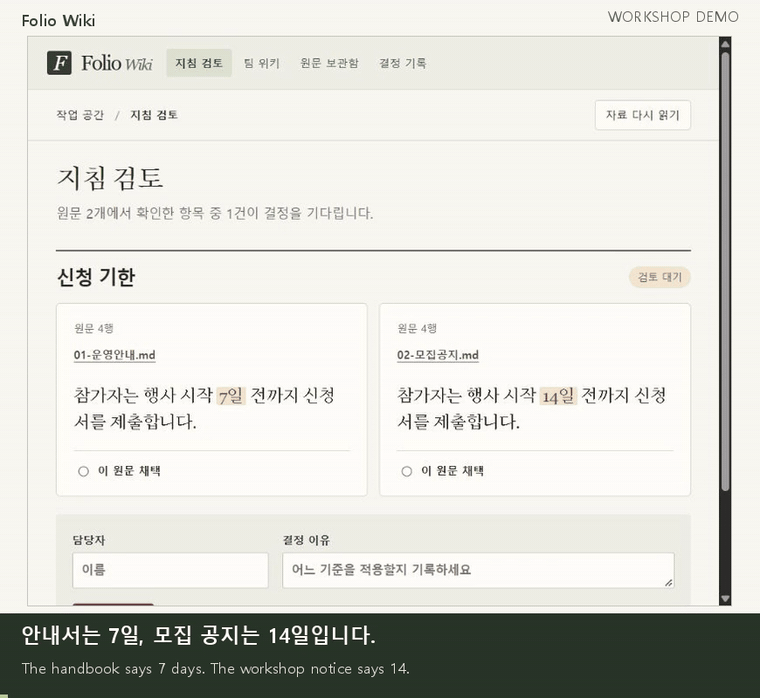

# Folio Wiki

[English](README.en.md)

**팀에서 정한 기준의 원문이 바뀌면, 그 기준을 다시 검토하게 하는 로컬 위키입니다.** 두 문서에 서로 다른 신청 기한이 적혀 있다고 해보세요. 담당자는 어느 쪽을 따를지 정하고 이유를 남깁니다. 나중에 공지가 고쳐지면 이전 결정이 재검토로 돌아옵니다. 그때 읽었던 원문도 다시 열 수 있습니다.

| 바로 실행 | 직접 개발한 기능 |
|---|---|
| Python 3.10 이상에서 `python run.py --demo` · [설치 순서](#직접-써보기) | 원문 버전 보관, 두 지침 비교, 채택 기록, 변경 후 재검토와 과거 원문 복원 · [구현 범위](#직접-만든-부분과-연결한-도구) |

**23초 데모**　모집 공지의 **14일** 기준 채택 → 공지를 **10일**로 수정 → **재검토 필요** → 당시의 **14일 원문** 확인.

[](docs/media/deadline-review.mp4)

[MP4 다운로드](https://github.com/SakJaeLim/folio-wiki/raw/refs/heads/main/docs/media/deadline-review.mp4) · [구성도](docs/ARCHITECTURE.md) · [실행 검증](docs/VALIDATION.md)

## 직접 써보기

Git과 Python 3.10 이상이 있는 PC에서 아래 세 줄을 실행하세요. 데모에는 Python 표준 라이브러리만 씁니다.

```bash
git clone https://github.com/SakJaeLim/folio-wiki.git
cd folio-wiki
python run.py --demo
```

1. [로컬 앱](http://127.0.0.1:8848/)에서 **14일**이 적힌 모집 공지를 선택합니다. 담당자와 이유를 적고 **결정 기록**을 누릅니다.
2. 서버를 켜 둔 채 같은 저장소의 두 번째 터미널에서 `python run.py --revise-demo`를 실행합니다. 이 명령은 데모용 모집 공지 사본의 기한을 10일로 바꿉니다.
3. 화면에 **재검토 필요**가 뜹니다. **결정 기록 → 결정 당시 원문**을 열면 14일이 적힌 공지를 읽을 수 있습니다.

데모의 문서와 이력은 `.state/`에 보관합니다. 다시 실행하면 이어서 볼 수 있습니다. Windows에서 `python` 명령이 없으면 `py -3`을, macOS나 Linux에서는 `python3`을 사용할 수 있습니다.

## 어디에 쓰나요?

| 사용 장면 | 팀이 확인할 수 있는 것 |
|---|---|
| 교육 운영팀이 모집 안내와 운영 매뉴얼을 함께 관리할 때 | 이번 회차에 채택한 기한, 담당자, 판단 이유 |
| 프로젝트 인수인계 중 예전 절차서와 새 공지가 다를 때 | 전임자가 읽었던 두 원문과 그 후 달라진 내용 |
| 팀 위키의 안내 문장을 원문 수정 후 다시 게시할 때 | 다시 결정할 항목과 과거 결정의 근거 |

같은 제목의 절에서 두 문서의 내용이 다르면 담당자가 적용할 원문과 **채택할 문장**을 선택합니다. 여러 문장을 함께 적용할 때는 ‘이 절 전체’를 고를 수 있습니다. 예전 버전에서 채택한 결정도 당시 선택한 절 전체를 기준으로 확인합니다.

선택한 문구나 그 안에서 참조한 Markdown 링크의 주소가 바뀌면 **채택 당시와 현재 원문**이 나란히 표시됩니다. 같은 파일의 다른 문장을 수정하면 채택 상태가 유지됩니다. 원문이 없어졌거나 대응 위치가 모호하면 담당자가 다시 확인합니다. 외부 웹페이지 내용이나 새로 추가된 별도 예외 조항의 의미는 자동으로 판정하지 않습니다.

## 직접 만든 부분과 연결한 도구

| 구성 | 이 프로젝트에서 맡은 일 |
|---|---|
| **Folio Wiki에서 직접 개발** | 폴더 변경 감지, 파일 해시와 인용 범위 보관, 원문 비교 화면, 채택·보류·철회 기록, 근거 변경 시 현재 안내 갱신, 과거 버전 복원 |
| [WeKnora](https://github.com/Tencent/WeKnora/tree/v0.9.0) | API로 폴더 버전을 받아 위키 초안 생성 |
| [PageIndex](https://github.com/VectifyAI/PageIndex/tree/2ac8694bf8fe89a3840dda9bdb88db5119b77fc4) | 선택 기능. 보관된 Markdown 원문에서 제목 목차와 줄 위치 탐색 |
| [jev-cli](https://github.com/tumf/jev-cli) | 선택 기능. 담당자가 요청하면 두 공개 인용문을 TypeSafe로 보내 검토 의견 표시 |

## 내 폴더에서 AI 위키 초안 만들기

공개 Markdown 폴더의 자동 초안까지 쓰려면 WeKnora v0.9.0과 Ollama가 필요합니다. Linux 또는 Windows WSL의 glibc 환경에서 Git, Go, C/C++ 컴파일러, SQLite 개발 헤더를 준비합니다. 같은 셸에서 아래 명령을 실행하세요. 첫 빌드와 모델 다운로드에는 시간과 저장 공간이 필요합니다.

```bash
ollama pull qwen2.5:3b
ollama pull nomic-embed-text
bash scripts/weknora-lite.sh
```

별도 터미널에서 아래 명령의 경로를 **공개해도 되는 UTF-8 Markdown 폴더**로 바꾸고 실행하세요.

```bash
python run.py --folder "/path/to/public-markdown" --weknora-url http://127.0.0.1:8794
```

[팀 위키 열기](http://127.0.0.1:8848/). 앱은 폴더를 4초마다 확인합니다. 폴더 버전마다 WeKnora 지식베이스를 만들고 생성된 초안을 표시합니다. 엔진에는 전용 시험 계정을 등록할 수 있어야 합니다. 다른 Ollama 주소는 `OLLAMA_BASE_URL`, 기존 엔진의 등록 모델 ID는 `FOLIO_CHAT_MODEL_ID`, `FOLIO_EMBED_MODEL_ID`로 설정합니다. PageIndex 0.2.10을 설치한 Python에서 원문 목차를 사용할 수 있습니다. Jev를 인증한 뒤 `--enable-jev`를 주면 검토 의견 버튼이 열립니다.

## 검증과 연구

공개 업무지침을 다시 돌렸을 때 기존 결정의 재검토는 17건에서 3건으로 줄었습니다. 국내 두 기관의 정정공고에서는 일반 문서 비교와 Folio 모두 바뀐 결정 3건을 찾았습니다. [공고 원문과 검증 결과](docs/research/revision-pilot.md)

공개 합성 자료에서 14일을 채택한 뒤 10일로 수정해 재검토와 과거 원문 복원을 확인했습니다. 로컬 CPU에서 첫 WeKnora 초안과 후속 목차 생성에는 약 9분이 걸렸습니다. Lite의 일부 출처 조회는 SQLite 경고를 남겼습니다. [실제 응답과 화면](docs/VALIDATION.md)

연구 질문은 **원문 변경 후 팀원이 폐기된 기준을 얼마나 자주 잘못 적용하는가**입니다. 문서 검색, 일반 위키, 이 도구에 같은 변경 이력과 업무 질문을 주고 오적용률, 불필요한 재검토율, 근거를 찾는 시간을 비교할 수 있습니다. 조직에서 얻는 효과는 아직 측정하지 않았습니다. [선행연구와 실험 방향](docs/research/README.md)

```bash
python -m unittest discover -s tests -v
```
