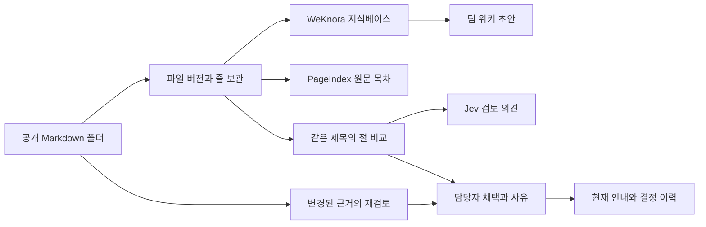

# 폴더에서 팀 안내까지

앱은 지정한 폴더에서 UTF-8 Markdown 파일을 읽고 원본 바이트의 SHA-256을 계산한다. 파일 경로와 해시의 집합이 폴더 버전이다. 파일 본문과 인용문의 시작·종료 줄을 SQLite에 보관한다. 숨김 폴더와 링크는 건너뛴다. 폴더를 읽는 도중 오류가 발생하면 이전 비교 결과를 유지한다.

각 폴더 버전에는 별도의 WeKnora 지식베이스를 사용한다. 파일 이름을 붙인 원문 묶음을 수동 Markdown 문서 한 건으로 게시한다. 서버가 실제로 반환한 페이지 본문을 초안으로 표시한다. WeKnora의 원문 참조는 이 묶음을 가리키고, 앱의 채택 근거는 묶기 전 개별 파일 버전을 가리킨다. 엔진 처리 전후의 상태는 화면에 표시한다. 버전마다 다시 생성하는 첫 구현이므로 큰 폴더에서는 처리량과 저장량을 측정해야 한다.

두 파일에 같은 제목 경로의 절이 있고 내용이 다르면 검토 후보를 만든다. 담당자가 한 원문을 선택하거나 안내를 철회하면 이름, 사유, 당시 모든 인용문을 한 트랜잭션으로 저장한다. 채택 요청 직전에 폴더를 다시 읽고 검토 세대가 바뀌었으면 오래된 화면의 요청을 거부한다. 파일을 고치거나 삭제하면 현재 안내에서 이전 채택을 내리고 과거 원문은 이력에서 계속 열 수 있다.

PageIndex는 저장한 특정 버전에서 제목과 줄 번호를 읽는다. Jev는 화면에서 명시적으로 요청한 두 공개 인용문만 받아 검토 필요, 함께 적용 가능, 근거 부족 중 하나를 제안한다. 결정 저장은 이 두 도구와 독립적으로 동작한다.

로컬 파일럿에서 담당자는 화면에 입력한 이름이다. 조직 계정 인증, 문서별 접근 권한과 클라우드 폴더 동기화는 구현 범위에 포함되지 않는다.
