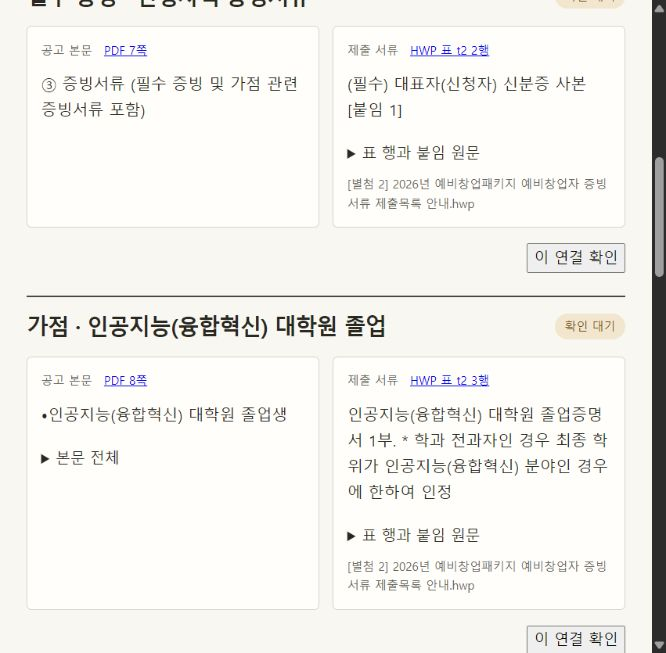

# 신청 요건과 HWP 제출 서류 대조

Folio에서 **공고 가져오기**를 열어 공식 URL을 입력한다. 왼쪽은 공고 본문, 오른쪽은 제출목록 표의 행이다. PDF 쪽 번호를 누르면 당시 본문이 열리고 HWP 표 위치를 누르면 당시 첨부 원본을 내려받을 수 있다. 한글 파일의 표 번호는 변환기가 붙인 위치 식별자다.



## 예비창업패키지

별첨 2의 첫 표에는 제목 행을 제외하면 7개 행이 있다. 그중 6개를 본문 기준 5건과 대조했다. 두 서류가 같은 부동산임대업 예외 요건에 속한다. [공식 공고와 별첨 2](https://www.bizinfo.go.kr/sii/siia/selectSIIA200Detail.do?pblancId=PBLN_000000000119859)

| 본문에서 확인한 기준 | 별첨 2에서 확인한 서류 |
|---|---|
| 7쪽 필수 증빙 제출 | 대표자 신분증 사본. 첨부가 허용 신분증 종류를 지정한다. |
| 8쪽 지정 인공지능 대학원 졸업 가점 | 졸업증명서 1부. 별첨 표가 가리키는 붙임 2에 서류명이 있다. |
| 8쪽 공고에 명시한 기간과 훈격을 충족하는 창업경진대회 수상 가점 | 입상실적 증명원 또는 상장 사본 |
| 8쪽 성실경영 심층평가를 통과한 청년의 서류평가 면제 | 심층평가 통과 확인증 |
| 3쪽 부동산임대업 보유자의 자격 예외 | 신청자 명의 사업자등록증 사본과 건강보험자격득실확인서. 후자는 4대 사회보험 가입자 명부로 대체 가능하다. 화면에서 발급일 조건도 확인할 수 있다. |

‘기타 증빙서류’ 행에는 특허, 도면, 계약서가 예시로 적혀 있다. 본문에서 대응하는 개별 요건을 특정할 수 없어 미연결로 표시했다. 제출 시점은 별첨 첫머리에서 확인할 수 있다. 창업사실 확인서류 등은 서류평가 통과 후 주관기관 안내에 따라 제출한다.

## 평택산업진흥원

기업 전시회 참가 지원사업의 공고 본문 5쪽과 붙임 4를 대조했다. 표가 나열한 12개 항목 모두 서류명과 번호가 일치했다. 필수 제출서류는 8개, 보유 시 제출하는 자료는 4개였다. 법인등기부등본을 함께 제출하는 조건은 사업자등록증 행에만 연결됐고, 공장등록증명서는 ‘보유 시’로 표시됐다. [평택 공식 공고](https://www.bizinfo.go.kr/sii/siia/selectSIIA200Detail.do?pblancId=PBLN_000000000119304)

두 기관의 실제 HWP를 서로 바꿔 넣은 별도 시험에서는 양쪽 모두 제출서류 연결이 0건이었다. 추가 회귀 시험에서는 행 번호가 같아도 서류명이 다르거나, 같은 가점 문구가 면제 절에만 있거나, 두 후보가 남으면 연결을 보류했다. 확인한 뒤 같은 파일에 무관한 행이 삽입되면 결정이 유지되고, 요구된 서명 방식이 바뀌면 재검토가 열렸다.

## 재현과 범위

[설치 안내](../../README.md)를 따라 `pdftotext`와 HWP 판독기를 준비하고 저장소 최상위에서 실행한다.

```sh
python -m experiments.exceptions.hwp_proof
python -m unittest discover -s tests -v
```

실험은 공고 두 건의 실제 PDF 및 HWP 원본 해시를 확인하고, 사전에 적어 둔 18개 행별 대조값을 검사한다. kordoc는 HWP를 문단과 표 셀로 변환한다. Folio는 병합된 칸의 범위, 붙임 번호, 제출 표의 머리글과 본문 조건을 대조한다. 스캔 이미지 속 표와 구조를 확정할 수 없는 자유 서식에는 같은 결과를 보장하지 않는다. 이 수치는 두 공고에서 확인한 결과다.
