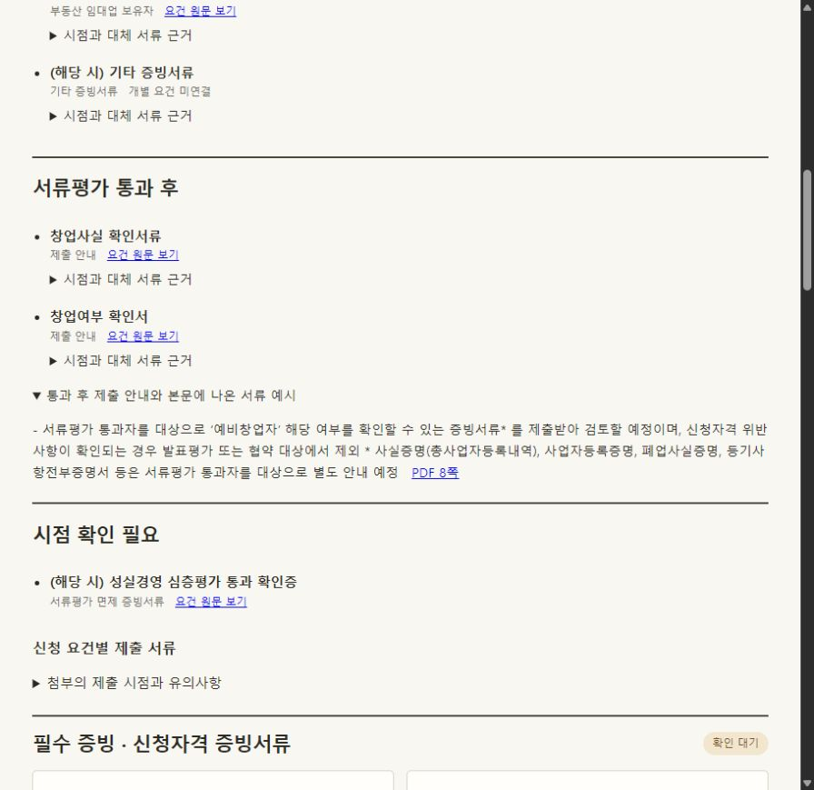

# 언제 어떤 서류를 제출하나

2026년 2차 예비창업패키지 수정 공고의 본문 7~8쪽과 별첨 2 첫 문단을 대조했다. 기업마당에서 받은 원본의 해시를 확인했다. [공식 공고와 별첨](https://www.bizinfo.go.kr/sii/siia/selectSIIA200Detail.do?pblancId=PBLN_000000000119859)

| 시점 | 화면에 표시한 자료 |
|---|---|
| 신청할 때 | 사업신청서 온라인 입력, 사업계획서 파일 첨부, 대표자 신분증 사본. 해당자는 가점 증빙, 부동산임대업 자격 예외 서류, 기타 참고자료 제출 |
| 서류평가 통과 후 | 창업사실 확인서류와 창업여부 확인서 등. 주관기관이 안내하며, 본문은 사실증명(총사업자등록내역), 사업자등록증명, 폐업사실증명, 등기사항전부증명서 등을 예시로 든다. |
| 시점 확인 필요 | 성실경영 심층평가 통과 확인증. 별첨 표에는 서류명이 있지만 첫 문단의 제출 시점 안내에는 이 항목이 없다. |

한 요건에 서류가 두 개면 각각의 출처를 보여준다. 예를 들어 임대업 신청자의 사업자등록증 사본과 건강보험자격득실확인서는 같은 요건에 속한다. 가입자 명부로 대체할 수 있다는 문구는 건강보험자격득실확인서에 연결된다. 화면에서 제출목록의 행과 그 행이 가리키는 붙임을 각각 확인할 수 있다.



## 실제 HWP 사본의 변경 시험

공식 원본은 그대로 보관하고 별도 시험 공간에서 7개 요건을 모두 확인했다. 표와 붙임의 구조를 보존한 HWP 사본에서 아래 문구를 한 번에 하나씩 바꿨다. 매번 원본으로 되돌린 뒤 다음 사례를 실행했다.

| 사본에 넣은 변경 | 재검토가 열린 요건 | 확인 유지 |
|---|---|---|
| 임대업 보유자 서류를 신청 시에서 서류평가 통과 후로 이동 | 임대업 자격 예외 1건 | 6건 |
| 붙임 6의 가입자 명부 대체를 가능에서 불가로 변경. 제출목록은 그대로 둠 | 임대업 자격 예외 1건 | 6건 |
| 붙임 6의 대체 서류명만 가입자 명부에서 시험용 재직증명서로 변경 | 임대업 자격 예외 1건 | 6건 |
| 제출목록의 대체 허용만 변경. 붙임 6은 그대로 둠 | 임대업 자격 예외 1건 | 6건 |
| 창업사실 확인서류만 통과 후에서 신청 시로 이동. 창업여부 확인서는 그대로 둠 | 통과자의 창업 여부 확인 1건 | 6건 |
| 페이지 삭제 안내의 표현만 변경 | 0건 | 7건 |

같은 변경본을 다시 가져와도 결과가 같았고, 원본을 다시 가져오면 7건 모두 원래 확인 상태로 돌아왔다. 이 시험의 변경은 공식 개정 이력이 아니다.

## 재현과 범위

[HWP 설치 안내](../../README.md)에 따라 환경을 준비한 뒤 저장소 최상위에서 실행한다.

```sh
python -m experiments.exceptions.submission_stages
python -m unittest discover -s tests -v
```

시점이 붙은 문단에서 명시적으로 지목한 서류나 분류만 연결한다. 서로 다른 시점이 동시에 명시되면 담당자가 원문을 확인하게 한다. 대체 문구는 해당 표 행이나 그 행이 지목한 붙임에서 찾는다. 처음 도입할 때 과거 HWP 판본을 특정할 수 있으면 당시 원본으로 비교 기준을 복원한다. 식별할 수 없는 과거 기록은 새로 확인할 조건으로 남을 수 있다.
